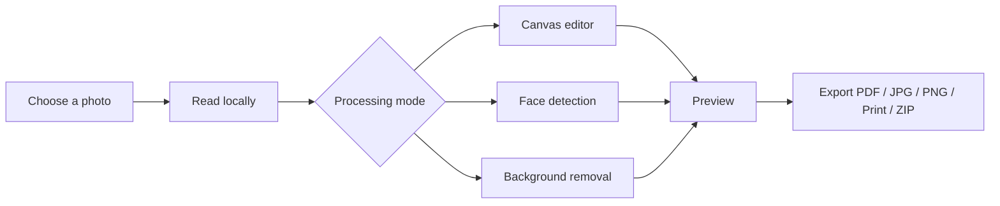

# SnapSheet 

<div align="center">


<br />

**Passport photos · Government forms · ID copies · Print-ready sheets**

<p>
  <a href="https://snapsheet-kritanshu.vercel.app/">🌐 Live Demo</a>
  ·
  <a href="#-quick-start">🚀 Quick Start</a>
  ·
  <a href="#-features">✨ Features</a>
  ·
  <a href="#-privacy-first">🔒 Privacy</a>
</p>

<p>
  
  
  
  
  
</p>


</div>

---

## 🎯 What Is SnapSheet?

SnapSheet is a free, private, browser-based photo utility that turns everyday phone photos into correctly sized passport photos, exam uploads, ID copies, collages, and print-ready sheets.

Everything happens locally in your browser. No account, cloud upload, server-side processing, or photo storage required.

> **Short version:** one photo, the right pixels, the right size, the right format, without uploading it anywhere.

---

## ✨ Features

<table>
<tr>
<td width="50%" valign="top">

### 🛂 Passport & Visa Photos

Create and export photos for 13 document types across 11 countries and regions.

- Automatic face detection and head framing
- On-device straightening and size guidance
- Head size, tilt, background, lighting, and sharpness checks
- White, off-white, light blue, and light grey backgrounds
- Sheets for 4 × 6 in, A4, A5, and US Letter
- Cut lines, optional name/date strip, PDF, print, or 600 DPI JPG
- Editable custom dimensions

</td>
<td width="50%" valign="top">

### 📝 Government & Exam Forms

Resize photos, signatures, thumbs, declarations, and postcard photos to published form requirements.

- SSC, IBPS/SBI, UPSC, NEET UG, and PAN presets
- Editable pixel dimensions and file-size limits
- Automatic signature and ink crop cleanup
- Best-fit JPEG quality without exceeding size limits
- Padding for minimum file-size requirements
- Direct download in the required format

</td>
</tr>
<tr>
<td width="50%" valign="top">

### 🪪 ID Card Copies

Prepare both sides of an ID card on a single true-size page.

- Four-point perspective correction
- Magnifier for precise corner placement
- 85.6 × 54 mm and custom card sizes
- A4 and US Letter layouts
- Colour, grayscale, and crisp-scan modes
- Purpose watermark for one-use copies
- Stacked, side-by-side, and multi-set layouts

</td>
<td width="50%" valign="top">

### 🖨️ Print Studio

Build photo sheets, contact sheets, prints, and collages with precise measurements.

- Grid, exact-print, and six collage layouts
- Real millimetre controls for margins, gaps, and borders
- Standard and custom paper sizes
- Crop, zoom, rotate, straighten, and mirror controls
- Ten looks plus brightness, contrast, saturation, and warmth
- Synced copies and fill-the-page mode
- PDF, JPG, PNG, ZIP, direct print, and phone share sheet

</td>
</tr>
</table>

---

## 🔒 Privacy First

<div align="center">

| Your photo | What happens |
|:---:|---|
| 📷 Selected on your device | Processed in the browser tab |
| ☁️ Uploaded to SnapSheet | Never |
| 🗄️ Stored on SnapSheet servers | Never—there are no SnapSheet servers for photos |
| 💾 Saved automatically | Only in local IndexedDB when autosave is enabled |
| 🤖 AI processing | Face detection and segmentation run on-device |

</div>

The card copy workflow also keeps card photos limited to the current tab and does not save them through the normal autosave flow.

---

## 🚀 Quick Start

### Prerequisites

- **Node.js 18 or newer**
- **npm**

### Run locally

```bash
git clone https://github.com/kritxnshu/SnapSheet-2.0.git
cd SnapSheet-2.0
npm install
npm run dev
```

Open **http://localhost:5173**.

### Available commands

| Command | Description |
|---|---|
| `npm run dev` | Start the Vite development server |
| `npm test` | Run the Vitest unit test suite |
| `npm run build` | Create a production build in `dist/` |
| `npm run preview` | Preview the production build locally |

---

## 🧭 App Routes

| Route | Tool |
|---|---|
| `/` | SnapSheet home and tool switcher |
| `/passport` | Passport and visa photo creator |
| `/form-photo` | Photo, signature, thumb, and declaration resizer |
| `/id-copy` | ID card perspective correction and copy sheets |
| `/studio` | Photo print and collage studio |

---

## 🛠️ Tech Stack

<div align="center">


</div>

- **React 18** for the interface
- **Vite 5** for development and production builds
- **Tailwind CSS 3** for responsive styling
- **Canvas 2D** for consistent previews and exports
- **jsPDF** for PDF generation
- **fflate** for ZIP exports
- **heic2any** for lazy-loaded HEIC/HEIF decoding
- **MediaPipe Tasks Vision** for on-device face detection and segmentation
- **IndexedDB** and a service worker for autosave and offline support

### How processing works



MediaPipe's WebAssembly runtime ships with the app. Vision models are downloaded once on first use of AI-assisted features and are then cached by the browser.

---

## 📁 Project Structure

```text
src/
├── components/       Shared UI, studio panels, cropper, and corner picker
├── lib/              Layout, rendering, export, imaging, filters, history, storage
│                     and on-device document/photo processing
├── pages/            Home, Passport, FormPhoto, IdCopy, and Studio routes
├── App.jsx           Routes and page-level loading
└── main.jsx          Application entry point

public/
├── icons/            App icons, favicon, and PWA artwork
├── manifest.webmanifest
└── sw.js             Offline service worker

vercel.json           SPA routing and asset cache headers
vite.config.js        Vite configuration
```

---

## 🌐 Deployment

SnapSheet is a static Vite application and can be deployed to Vercel, Netlify, Cloudflare Pages, GitHub Pages, or any modern static host.

The included `vercel.json`:

- Rewrites app routes to `index.html`
- Keeps the service worker uncached
- Applies immutable caching to hashed assets
- Supports MediaPipe assets at `/mediapipe/`

### Deploy to Vercel

```bash
npm install -g vercel
vercel
```

For hosts that do not read Vercel configuration, enable an SPA fallback from all application routes to `index.html`.

---

## 🧪 Quality & Browser Support

The unit suite covers layout math, rendering helpers, filters, undo history, passport framing and checks, form file sizing, perspective correction, and DPI metadata.

SnapSheet targets recent versions of:

- Google Chrome / Chromium
- Microsoft Edge
- Mozilla Firefox
- Safari on macOS and iOS

Some advanced features, such as clipboard access and direct share/download behaviour, depend on browser support and secure-context permissions.

> MediaPipe and browser canvas features are used with progressive fallbacks where possible.

---

## ⚠️ Document Requirements

SnapSheet is a formatting aid, not an official authority. Government and document requirements can change.

Before submitting a photo, always verify:

- Pixel dimensions and file size
- Background colour
- Head position and dimensions
- Recent vs. newly captured photos
- Official file type requirements

The app highlights that requirements can change and keeps size, pixel, and KB values editable.

---

## 🤝 Contributing

Contributions, bug reports, and feature suggestions are welcome.

1. Fork the repository.
2. Create a focused branch.

   ```bash
   git checkout -b feature/my-improvement
   ```

3. Make your change and run tests.

   ```bash
   npm test
   npm run build
   ```

4. Commit the change with a clear message.
5. Open a pull request with screenshots or steps for UI changes.

Please keep generated files, dependencies, and unrelated formatting changes out of pull requests.

---

## 🗺️ Roadmap Ideas

- Additional country passport presets
- Multi-language interface
- More government form specifications
- Batch passport-sheet exports
- Custom printable proof sheets
- Stronger browser privacy indicators
- Expanded automated test coverage

Have a useful preset or feature request? Open an issue with the official specification or an example notice.

---

## 🧑‍💻 Author

Built with care by **Kritanshu Krishnan**.

<div align="center">

<a href="https://github.com/kritxnshu">
  
</a>

<a href="https://snapsheet-kritanshu.vercel.app/">
  
</a>

<br /><br />


</div>
